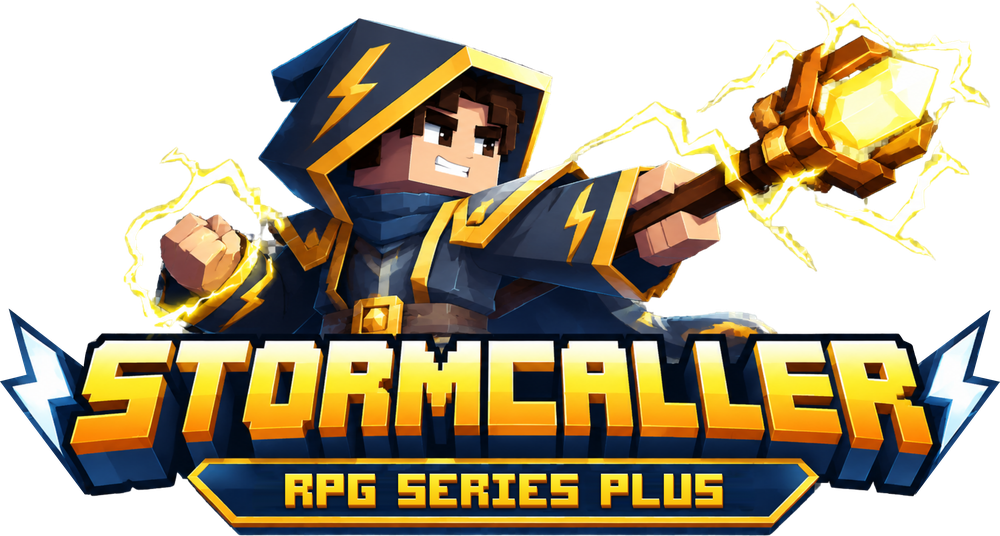

  

# Stormcaller (RPG Series Plus)

Stormcaller (RPG Series Plus) adds Lightning as a fourth school of magic to Wizards (RPG Series): lightning spells, robes, staves, wands and a spell book, with optional Skill Tree and Curios support.

Stormcaller is an unofficial addon for [Wizards (RPG Series)](https://www.curseforge.com/minecraft/mc-mods/wizards) by Daedelus. It is not made by or affiliated with the original author.

- Minecraft 1.21.1 / NeoForge
- Install it on both client and server.

## Required

- [Wizards (RPG Series)](https://www.curseforge.com/minecraft/mc-mods/wizards)
- [Spell Engine](https://www.curseforge.com/minecraft/mc-mods/spell-engine)
- [Spell Power Attributes](https://www.curseforge.com/minecraft/mc-mods/spell-power)
- [Armor Model API](https://www.curseforge.com/minecraft/mc-mods/armor-model-api)

**Recommended:** [Better Combat](https://www.curseforge.com/minecraft/mc-mods/better-combat-by-daedelus) for proper weapon
mechanics, [RunelessRPG](https://www.curseforge.com/minecraft/mc-mods/runelessrpg) to cast with mana instead of runes.

**Optional:** [Curios API](https://www.curseforge.com/minecraft/mc-mods/curios) (jewelry and relics),
[Skill Tree (RPG Series)](https://www.curseforge.com/minecraft/mc-mods/skill-tree) (Stormcaller skill tree tab),
[Combat Roll](https://www.curseforge.com/minecraft/mc-mods/combat-roll) (roll passives of the skill tree),
[Better End](https://www.curseforge.com/minecraft/mc-mods/betterend-neoforge) (Amber Lightning Staff).

## Links

- Wiki: https://github.com/Drehverschluss/Stormcaller/wiki
- Issues: https://github.com/Drehverschluss/Stormcaller/issues
- CurseForge: coming soon

## License

MIT, see [LICENSE](LICENSE). Credits for dependencies and integrations are in [CREDITS.md](CREDITS.md).
