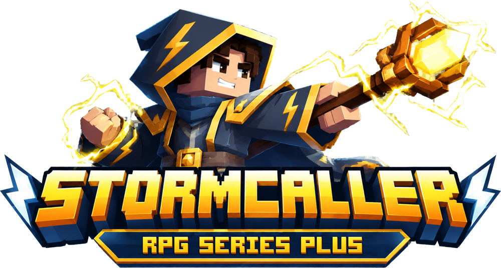
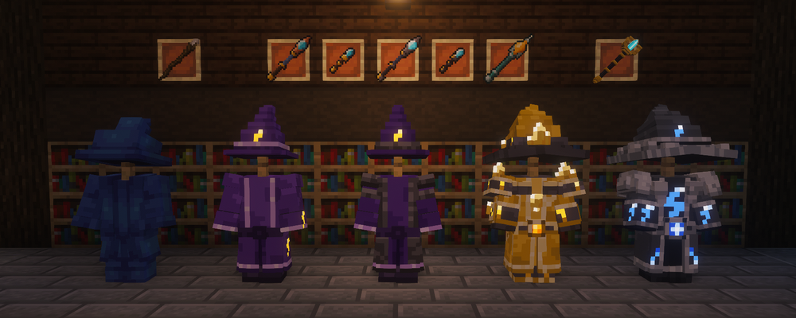
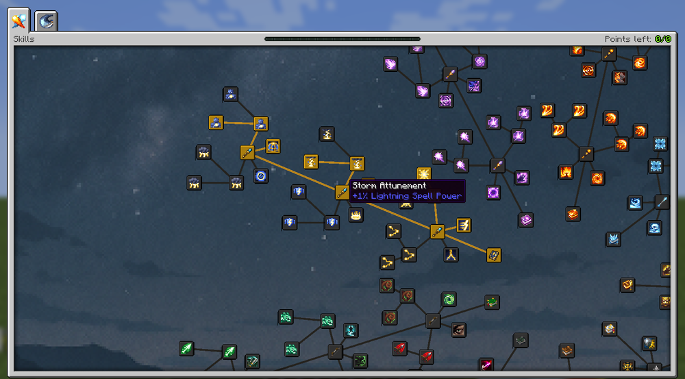

  

# Stormcaller (RPG Series Plus)

Stormcaller (RPG Series Plus) adds Lightning as a fourth school of magic to Wizards (RPG Series): lightning spells, robes, staves, wands and a spell book, with optional Skill Tree and Curios support.

Stormcaller is an unofficial addon for [Wizards (RPG Series)](https://www.curseforge.com/minecraft/mc-mods/wizards) by Daedelus. It is not made by or affiliated with the original author.

- Minecraft 1.21.1 / NeoForge
- A version for Forge 1.20.1 (bug fixes only) is in the branch [1.20.1](https://github.com/Drehverschluss/Stormcaller/tree/1.20.1).
- Install it on both client and server.

  

## Skill tree

With [Skill Tree (RPG Series)](https://www.curseforge.com/minecraft/mc-mods/skill-tree), Stormcaller is a class in the
Class Skills tab, right next to the eight classes of the RPG Series, and Lightning Bolt has three nodes in the Weapon
Skills tab. With More RPG Classes – Skill Tree it joins that circle too. Details are in the
[wiki](https://github.com/Drehverschluss/Stormcaller/wiki/Skill-Tree).

  

## Robe look

Since 0.3.0 the robes follow the style of the Wizards robes (my own models and textures). The old look of 0.1/0.2 is
built in as the resource pack **Stormcaller_Original_Armor** (*Options → Resource Packs*, client only). Pack id for
modpacks: `mod/stormcaller:resourcepacks/stormcaller_original_armor`.

## Required

- [Wizards (RPG Series)](https://www.curseforge.com/minecraft/mc-mods/wizards)
- [Spell Engine](https://www.curseforge.com/minecraft/mc-mods/spell-engine)
- [Spell Power Attributes](https://www.curseforge.com/minecraft/mc-mods/spell-power)
- [Armor Model API](https://www.curseforge.com/minecraft/mc-mods/armor-model-api)

## Recommended

- [Better Combat](https://www.curseforge.com/minecraft/mc-mods/better-combat-by-daedelus) – for proper weapon mechanics
- [RunelessRPG](https://www.curseforge.com/minecraft/mc-mods/runelessrpg) – cast with mana instead of runes

## Optional

- [Curios API](https://www.curseforge.com/minecraft/mc-mods/curios) – jewelry and relics (Accessories works too, through
  a Curios compatibility layer)
- [Skill Tree (RPG Series)](https://www.curseforge.com/minecraft/mc-mods/skill-tree) – Stormcaller as a class in the
  Class Skills tab and Lightning Bolt nodes in the Weapon Skills tab
- [Combat Roll](https://www.curseforge.com/minecraft/mc-mods/combat-roll) – the roll passives of the skill tree
- [Better End](https://www.curseforge.com/minecraft/mc-mods/betterend-neoforge) – the Amber Lightning Staff

## Links

- Wiki: https://github.com/Drehverschluss/Stormcaller/wiki
- Issues: https://github.com/Drehverschluss/Stormcaller/issues
- CurseForge: https://www.curseforge.com/minecraft/mc-mods/stormcaller-rpg-series-plus

## License

MIT, see [LICENSE](LICENSE). Credits for dependencies and integrations are in [CREDITS.md](CREDITS.md).
