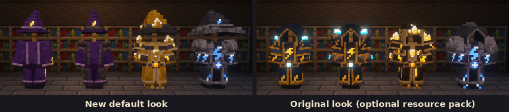

  

# Stormcaller (RPG Series Plus)

Stormcaller (RPG Series Plus) adds Lightning as a fourth school of magic to Wizards (RPG Series): lightning spells, robes, staves, wands and a spell book, with optional Skill Tree and Curios support.

Stormcaller is an unofficial addon for [Wizards (RPG Series)](https://www.curseforge.com/minecraft/mc-mods/wizards) by Daedelus. It is not made by or affiliated with the original author.

- Minecraft 1.21.1 / NeoForge
- Install it on both client and server.

  

## New robe look in 0.3.0

Since 0.3.0 the robes have a new default look in the style of the Wizards robes. I made the models and textures myself
from scratch, no files from other mods are used. The old look of 0.1/0.2 is still built in as the resource pack
**Stormcaller_Original_Armor**: turn it on in *Options → Resource Packs* (move it to the right, *Done*). It works without
a restart, only changes what you see on your own client, and servers need nothing. Pack id for modpacks:
`mod/stormcaller:resourcepacks/stormcaller_original_armor`.

  

## Required

- [Wizards (RPG Series)](https://www.curseforge.com/minecraft/mc-mods/wizards)
- [Spell Engine](https://www.curseforge.com/minecraft/mc-mods/spell-engine)
- [Spell Power Attributes](https://www.curseforge.com/minecraft/mc-mods/spell-power)
- [Armor Model API](https://www.curseforge.com/minecraft/mc-mods/armor-model-api)

## Recommended

- [Better Combat](https://www.curseforge.com/minecraft/mc-mods/better-combat-by-daedelus) – for proper weapon mechanics
- [RunelessRPG](https://www.curseforge.com/minecraft/mc-mods/runelessrpg) – cast with mana instead of runes

## Optional

- [Curios API](https://www.curseforge.com/minecraft/mc-mods/curios) – jewelry and relics (Accessories works too, through
  a Curios compatibility layer)
- [Skill Tree (RPG Series)](https://www.curseforge.com/minecraft/mc-mods/skill-tree) – the Stormcaller skill tree tab
- [Combat Roll](https://www.curseforge.com/minecraft/mc-mods/combat-roll) – the roll passives of the skill tree
- [Better End](https://www.curseforge.com/minecraft/mc-mods/betterend-neoforge) – the Amber Lightning Staff

## Links

- Wiki: https://github.com/Drehverschluss/Stormcaller/wiki
- Issues: https://github.com/Drehverschluss/Stormcaller/issues
- CurseForge: coming soon

## License

MIT, see [LICENSE](LICENSE). Credits for dependencies and integrations are in [CREDITS.md](CREDITS.md).
